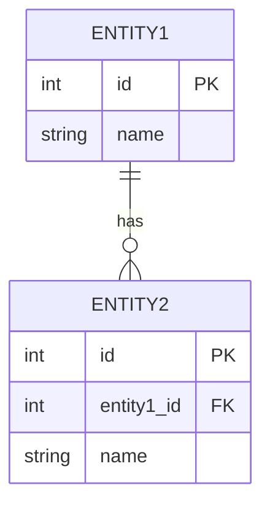

# 🗃️ Entity Relationship Diagram (ERD)

## Entitas & Atribut

### Entitas 1: [Nama Entitas]

| Atribut | Tipe Data | Keterangan |
|---------|-----------|------------|
| id | INT (PK) | Primary Key |
| | | |
| created_at | TIMESTAMP | |
| updated_at | TIMESTAMP | |

### Entitas 2: [Nama Entitas]

| Atribut | Tipe Data | Keterangan |
|---------|-----------|------------|
| id | INT (PK) | Primary Key |
| | | |
| created_at | TIMESTAMP | |
| updated_at | TIMESTAMP | |

## Relasi Antar Entitas

| Entitas A | Relasi | Entitas B | Keterangan |
|-----------|--------|-----------|------------|
| | one-to-many | | |
| | many-to-many | | |

## Diagram ERD

<!-- Tambahkan gambar ERD di sini atau gunakan Mermaid -->

