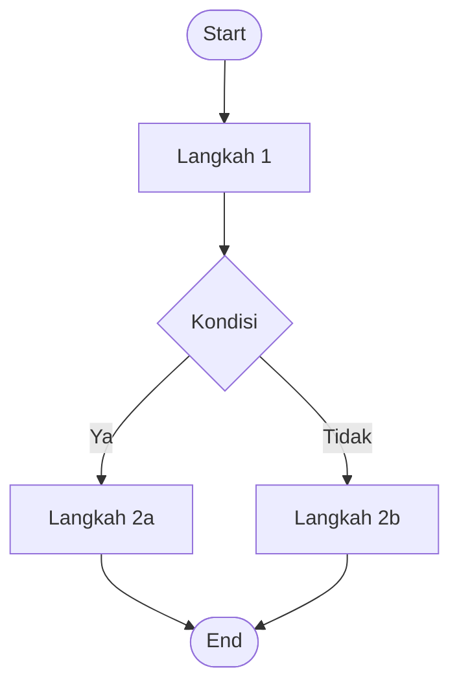

# 🔀 User Flow

## Overview

<!-- Gambaran umum alur pengguna dalam aplikasi -->

## Alur Pengguna

### Flow 1: [Nama Flow]

```
[Start] → [Langkah 1] → [Langkah 2] → [Langkah 3] → [End]
```

**Deskripsi:**
<!-- Jelaskan alur ini secara detail -->

---

### Flow 2: [Nama Flow]

```
[Start] → [Langkah 1] → [Langkah 2] → [End]
```

**Deskripsi:**
<!-- Jelaskan alur ini secara detail -->

## Diagram User Flow

<!-- Tambahkan gambar diagram user flow di sini -->



## Catatan

<!-- Catatan tambahan tentang user flow -->
