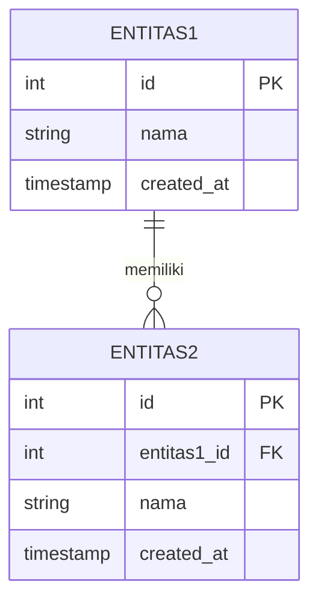

# 🗃️ Template: ERD

> Gunakan template ini untuk mendokumentasikan entitas dan relasinya.

## Entitas: `[NamaEntitas]`

**Deskripsi:** <!-- Jelaskan entitas ini -->

| Kolom | Tipe Data | Constraint | Keterangan |
|-------|-----------|------------|------------|
| `id` | BIGINT UNSIGNED | PK, AUTO_INCREMENT | Primary Key |
| `[kolom]` | VARCHAR(255) | NOT NULL | |
| `[kolom]` | TEXT | NULL | |
| `[fk_kolom]` | BIGINT UNSIGNED | FK | Foreign Key ke tabel `[tabel_lain]` |
| `created_at` | TIMESTAMP | NULL | |
| `updated_at` | TIMESTAMP | NULL | |

**Relasi:**
- Memiliki banyak `[Entitas]` (one-to-many)
- Dimiliki oleh `[Entitas]` (many-to-one)
- Memiliki banyak `[Entitas]` melalui `[pivot_table]` (many-to-many)

---

## Entitas: `[NamaEntitas]`

**Deskripsi:** <!-- Jelaskan entitas ini -->

| Kolom | Tipe Data | Constraint | Keterangan |
|-------|-----------|------------|------------|
| `id` | BIGINT UNSIGNED | PK, AUTO_INCREMENT | Primary Key |
| `[kolom]` | VARCHAR(255) | NOT NULL | |
| `created_at` | TIMESTAMP | NULL | |
| `updated_at` | TIMESTAMP | NULL | |

**Relasi:**
- 

---

## Diagram ERD (Mermaid)

